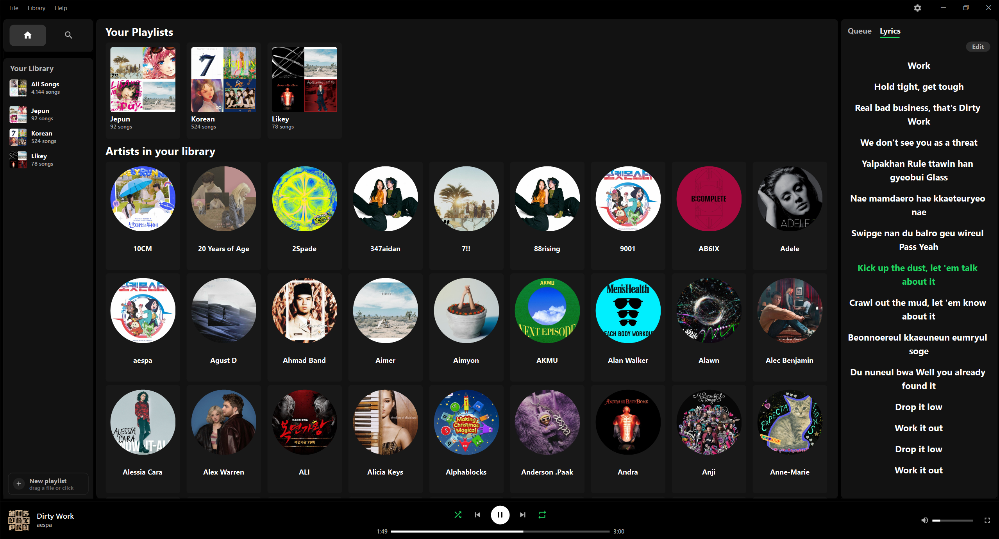
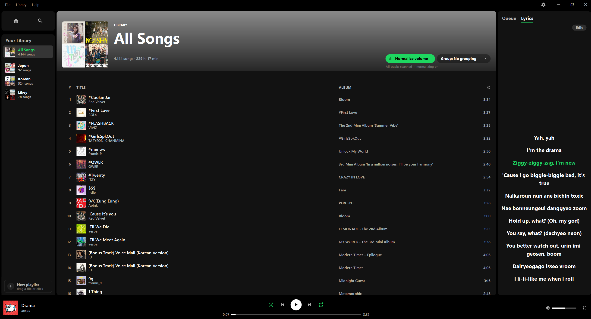
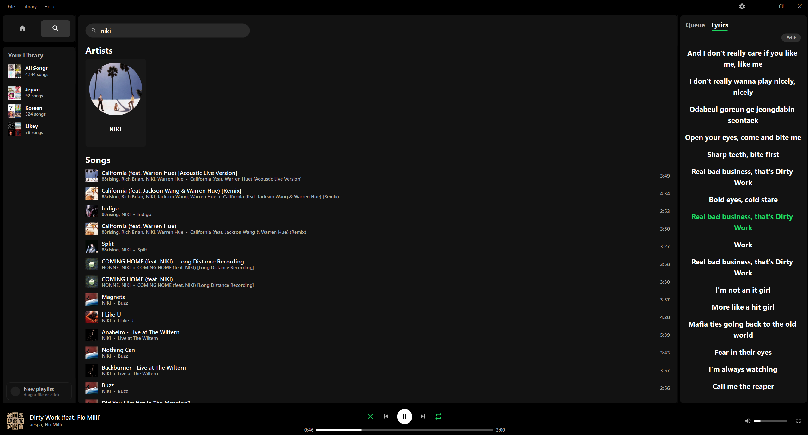
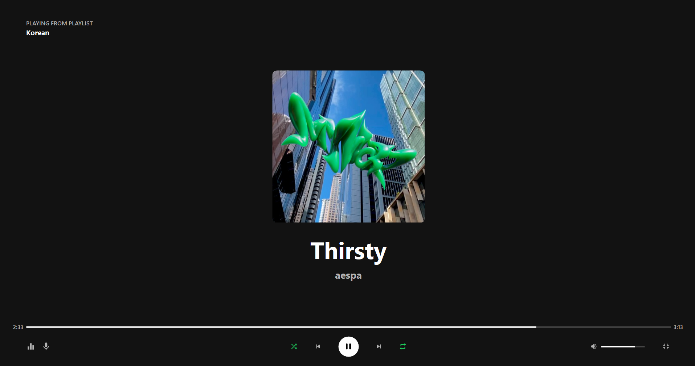
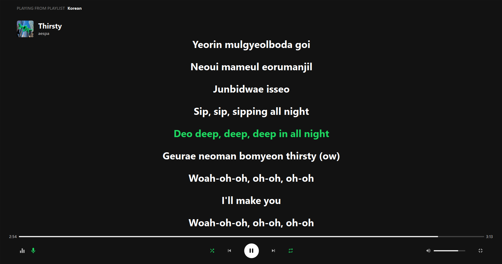
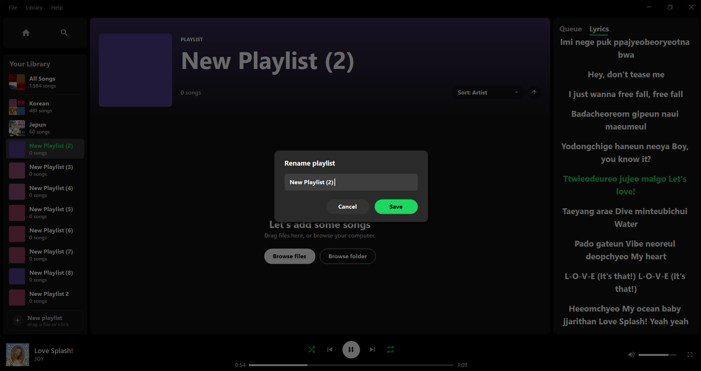

<div align="center">

# Verdant

### A modern Spotify-style theme for foobar2000

*A foobar2000 skin that turns the world's most configurable audio player into something
that looks like a modern streaming app.*

[](https://github.com/superziper/verdant-foobar2000-theme/releases/latest)
[](https://github.com/superziper/verdant-foobar2000-theme/releases)


**Four-step install. No components to hunt down. No fonts to install.**



</div>

---

**Verdant** is a modern **foobar2000 theme** — a complete visual skin that restyles your **local**
music library and playlists into a clean, dark, Spotify-inspired interface.

Everything on screen is custom-drawn in a [JSplitter](https://hydrogenaud.io/) panel running under
[Columns UI](https://github.com/reupen/columns_ui) — sidebar, home, playlist and All Songs views,
search, queue and lyrics pane, player bar, fullscreen mode, even the window title bar. No stock
foobar2000 widgets are involved, which is why it looks nothing like default foobar2000.

It does **not** connect to Spotify's service and plays nothing you don't already own — it's a
look, not a client.

---

## Screenshots

<table>
<tr>
<td width="50%"><br><sub><b>Playlist</b></sub></td>
<td width="50%"><br><sub><b>All Songs</b></sub></td>
</tr>
<tr>
<td><br><sub><b>Search</b></sub></td>
<td><br><sub><b>Artist</b></sub></td>
</tr>
<tr>
<td><br><sub><b>Fullscreen</b></sub></td>
<td><br><sub><b>Lyrics</b></sub></td>
</tr>
<tr>
<td><br><sub><b>Visualizer</b></sub></td>
<td><br><sub><b>Editing</b></sub></td>
</tr>
</table>

---

## Features

- **Home** — a horizontal shelf of your playlists with 2×2 cover mosaics, above a grid of every
  artist in your library.
- **Playlist view** — gradient header tinted from the cover art, sortable by title / artist / album,
  inline rename, delete, and drag-and-drop import **with duplicate detection**.
- **All Songs** — your entire library in one virtualised list, optionally grouped by artist, album,
  or both. Handles thousands of tracks without stuttering.
- **Search** — instant, across artists and tracks, as you type.
- **Queue / Lyrics pane** — what's actually playing next (real playback queue *and* "next from"),
  or synced `.lrc` / plain `.txt` lyrics that roll with the track. Click any queue row to jump to it.
- **Fullscreen mode** — big now-playing art, rolling lyrics, or an FFT audio visualizer fed from
  real PCM. Four visualizer styles.
- **Normalize volume** — one button that levels your whole library so you stop reaching for the
  volume knob between albums. [How it works ↓](#normalize-volume)
- **Shuffle that tells the truth** — shuffle plays from a hidden shuffled copy of the playlist, so
  the "next up" list is the *actual* upcoming order, not a guess.
- **Discord presence** — the playing track on your Discord profile, with album art and a live
  progress bar, the way Spotify does it. On by default; your files are never uploaded. Only the
  title, artist and album are sent, to the Discord app on this machine.
- **Custom title bar** — frameless window with real File / Library / Help menus, window controls,
  and a gear that opens the settings page.
- **Settings in the theme** — UI scale, output ceiling, wheel step and Discord presence as real
  controls, applied the moment you pick them. No properties dialog, no panel reload.
- **Space plays and pauses** — anywhere except where you're typing, like every other player.

---

## Install

1. Install foobar2000 as **portable** from the [official website](https://www.foobar2000.org/download).
2. Download **`Verdant-vX.Y.Z.zip`** from the
   **[latest release](https://github.com/superziper/verdant-foobar2000-theme/releases/latest)**.
3. Extract the **`profile`** folder from the zip into foobar2000's **root folder** (the one containing
   `foobar2000.exe`).
4. Start foobar2000 and enjoy.

That's it. Columns UI, JSplitter and UI Wizard are bundled — nothing to install separately. And
**no fonts to install**: Verdant uses Segoe UI and Segoe MDL2 Assets, both of which ship with
Windows 10 and 11.

> For a **standard (non-portable)** install, extract the *contents* of `profile` into
> `%APPDATA%\foobar2000-v2` instead, then start foobar2000.

### Already have a foobar2000 you've set up?

**Don't extract over it** — `profile` carries a layout and core settings that would replace your own.
Close foobar2000, double-click **`install.bat`**, start foobar2000.

The installer checks before it writes. It adds only the components you're missing, and if you already
use Columns UI it replaces **only the panel layout** — your colours, fonts, playlist columns and
filters survive, because it uses Columns UI's own layout import rather than overwriting its config.
It backs up whatever it touches and writes an `uninstall.ps1` beside the backup in
`<profile>\verdant-backup\<date>\`.

<details>
<summary>Prefer to import the layout yourself?</summary>

`extras\verdant-layout.fcl` is the layout on its own. Copy `profile\verdant\` into your profile, then
Preferences → Display → Columns UI → **Import**, ticking **Main Layout** and **Toolbar Layout**.
</details>

### Uninstall

Run `uninstall.ps1` from `<profile>\verdant-backup\<date>\`, then delete `<profile>\verdant\`.

---

## First run

> **Home and All Songs look empty?** Verdant reads foobar's **Media Library**, not your playlists. A
> fresh foobar has an empty library, so add a music folder under Preferences → **Media Library**.
> That's expected, not a broken install.

Lyrics are read from a `.lrc` (synced) or `.txt` (plain) file sitting next to the audio file, with the
same name.

---

## Settings

Click the **gear** at the right of the title bar, just inside the window buttons.

| Setting | Default | What it does |
|---|---|---|
| **UI scale** | Auto | Scales every font, icon and the title bar. Auto follows your display's scaling; pick `100%` for a compact look, higher for a large or 4K screen. |
| **Output ceiling** | Full range | Lowers the top of the volume slider, in dB below foobar's own maximum. Worth setting on a system with plenty of gain downstream, where the top of the scale is unusable and the slider's travel is better spent lower. |
| **Wheel step** | Normal (180 px) | How far one wheel notch scrolls a list. |
| **Discord presence** | On | Shows the playing track on your Discord profile. Off turns it off completely: nothing is published and no connection to Discord is opened. Needs the bundled `foo_verdant` component. |

Changes apply as you make them — including UI scale, which rebuilds the fonts and the title bar in
place. Nothing here needs a panel reload.

The four values live in the panel's own property store, so they travel with your layout. Right-click
→ **Properties** still edits the same four and remains useful for typing an exact value the page
doesn't offer as a preset (`-8` dB, say) — the page shows whatever is actually stored.

Sidebar and queue-pane widths are still code: `M.navW` / `M.queueW` in
[`theme/verdant/core/tokens.js`](theme/verdant/core/tokens.js).

---

## Collaborations

A track credited to several artists shows up under **each** of them, and an artist never appears
twice. Verdant works that out in two steps, and only one of them involves a judgement call.

**1. How many artists a track has comes from the file, and only from the file.**

FLAC/Vorbis and ID3v2.4 can store several values in one `ARTIST` or `ALBUM ARTIST` field. Verdant
reads those values as written — three values, three artists. It does **not** try to take a single
value apart on punctuation, so a track tagged `Ariana Grande, Justin Bieber` as one string is one
artist, and gets its own card.

That is deliberate. Splitting on `,` `&` `feat.` works most of the time, and the times it fails are
invisible: `TOMORROW X TOGETHER`, `HUNTR/X`, `K/DA`, `Dan + Shay` and `Andra, The Backbone` all
contain something that looks like a separator, and a card that has been quietly torn in half looks
exactly like a correct one. A collab string sitting there whole is obvious, and fixing it at the
source fixes it in **every** player, not just this one.

> **Seeing `A, B` as an artist?** That track stores both names in a single tag value. Retag it with
> two values — in foobar: select the track → **Properties** → the `ARTIST` field → put each artist on
> its own line. Picard and most taggers write multi-value tags correctly by default.

**2. Different spellings of the same artist are folded together.**

`BLACKPINK` / `Blackpink` / `BLACKPINK (블랙핑크)` are one artist, as are `Anne-Marie` and
`Anne‐Marie` (different Unicode dashes). The spelling your library uses most becomes the label. A
*trailing* bracket is treated as an alias and dropped — leading ones are kept, so `(G)I-DLE`
survives.

> **Note:** this applies to the artist grid, search and artist pages. **All Songs → group by
> artist** still groups on the raw tag, because one track cannot sit in two groups of a single
> flat list.

---

## Normalize volume

**All Songs → Normalize volume** makes every track in your library play back at the same loudness.

Under the hood this is **ReplayGain**, which is two separate things — and the button owns both:

1. **A loudness measurement per track**, stored as a `REPLAYGAIN_TRACK_GAIN` tag in the file.
2. **Playback applying that measurement** (foobar's ReplayGain source mode).

The pill turns **green only when both are true**, so it can never claim to be on while doing nothing.
The line underneath tells you where you stand — e.g. `1,204 of 3,000 tracks scanned`.

| State | Clicking it |
|---|---|
| Some tracks unscanned | Asks first, then scans them and switches normalizing on |
| All scanned, normalizing off | Switches it on — instant, no rescan |
| Normalizing on (green) | Switches it off. Tags are left alone, so switching back on is instant |

**The scan writes tags into your audio files**, which is why it asks first. The scan itself is
foobar's own — its progress window, its *update file tags* confirmation — so you can cancel there and
nothing is written. Only unscanned tracks are ever handed to it. A large library takes a while the
first time, but it's a one-off.

Nothing here is destructive: no audio is re-encoded, no tag is removed. To undo it completely, use
foobar's own *ReplayGain → Remove ReplayGain information from files*.

---

## Requirements

- **foobar2000 v2, 64-bit** (developed and tested on 2.25)
- **Windows 10 or 11**
- Bundled and installed for you: **Columns UI**, **JSplitter** (`foo_uie_jsplitter`),
  **UI Wizard** (`foo_ui_wizard`, optional — without it you keep the normal Windows title bar)
  and **`foo_verdant`**, Verdant's own component for the Discord card (optional — without it
  everything else works, there's just no presence)

---

## FAQ

**Is this a theme or a skin?** Both words get used for the same thing in the foobar2000 world.
Verdant is a full visual replacement — layout, colours, fonts, every control — not a colour tweak.

**Will it change how my music sounds?** No. Verdant is purely visual. The one exception is
*Normalize volume*, which you have to switch on yourself and which uses foobar2000's own ReplayGain.

**Does it work with foobar2000 v1.x?** No — v2, 64-bit only.

**Can I still use the Default UI / my old Columns UI layout?** Yes. Columns UI keeps layout presets,
so you can switch back at Preferences → Display → Columns UI → Layout. If you installed with
`install.bat`, your previous layout is also backed up and restorable.

**Is my music library safe?** Verdant never touches your audio files. The one feature that writes
anything is *Normalize volume*, which asks first and writes only ReplayGain tags.

**Does Verdant send anything anywhere?** One thing, and only while Discord presence is on: the
playing track's title, artist and album, to the Discord app on your own machine. Album covers are
looked up by artist and album name against public catalogues so that nothing of yours is uploaded.
Everything else — your library, playlists and files — stays local. To switch it off, turn
**Discord presence** off in [Settings](#settings).

**It looks huge / tiny on my screen.** Set **UI scale** in [Settings](#settings) — it takes effect
as you pick it, so you can see the result and adjust again from the same page.

---

## For developers

```
theme/verdant/        the theme — copied verbatim into <profile>\verdant\
  main.js             entry point: declares the panel, sets the module load order
  core/               props, tokens, utils, title formats, memory caps, job scheduler
  data/               art, library, playback, lyrics, replaygain, dedupe, playlist edit, discord
  ui/                 skeletons + shimmer, window chrome and shared widgets
  views/              nav, playlist, home, artist, songs, search, settings, queue, bar, fullscreen
  app.js              panel state, layout, paint dispatch, input, foobar callbacks
components/           the bundled components: three third-party, plus foo_verdant
native/               foo_verdant's C++ source -- see native/README.md
  foo_verdant/        the Discord component: pipe client, activity, cover-art lookup
dist-config/          layout + core config harvested from a clean-room foobar
tools/
  deploy.ps1          dev sync into the foobar profile ( -Watch to auto-sync )
  install.ps1/.bat    the shipped installer
  harvest.ps1         pull configuration out of the clean-room rig
  make-release.ps1    build Verdant-vX.Y.Z.zip
```

Every module is evaluated into **one shared global scope**, so any module can call into any other.
`main.js` fixes the load order because a few things are computed at load time (fonts from `UISCALE`,
the reveal-gate ceiling from `ART_CAP`).

Settings are panel properties, read once in `core/props.js` and written back by the `apply*`
functions at the bottom of that file — each of which updates the running value as well as the
stored one, which is why none of them needs a reload. `applyUIScale` is the interesting case: it
rebuilds the whole font table (`buildFonts`) and the title-bar metrics (`chromeMetrics`), the only
two things `UISCALE` feeds. Adding a setting means a constant in `PROP`, a value, an `apply*`, and a
row in `cfgModel` in [`views/settings.js`](theme/verdant/views/settings.js).

The whole theme runs on **one thread shared with the UI**, which is why the code caches aggressively,
slices long builds across timer ticks, and scopes repaints to the one panel that changed.

```powershell
setx VERDANT_PROFILE D:\foobar2000\profile     # once, so deploy knows where to put it
.\tools\deploy.ps1 -Watch                      # mirrors theme\verdant into the profile on every save
```

`deploy.ps1` auto-detects a standard install; for a portable one, set `VERDANT_PROFILE` as above or
pass `-FoobarProfile`.

Then reload the panel (right-click → Reload). `console.log` goes to foobar's console (View → Console).
Deploy copies the same folder to the same place the installer does, so there's no separate build and
no second code path.

---

## Credits

Built by **[superziper](https://github.com/superziper)**.

Standing on: [Columns UI](https://github.com/reupen/columns_ui) by Reupen Shah, **JSplitter** by LUR,
and [UI Wizard](https://github.com/The-Wizardium/UI-Wizard) by The Wizardium.

## Licence

Verdant is [MIT licensed](LICENSE) — its own code is everything under `theme/`, `tools/`,
`dist-config/` and `docs/`.

The three foobar2000 components bundled for the one-step install are **not** Verdant's work and keep
their own licences (Columns UI is LGPL-3.0, UI Wizard is MIT). See
[THIRD-PARTY-NOTICES.md](THIRD-PARTY-NOTICES.md).

Not affiliated with or endorsed by Spotify. "Spotify" is a trademark of Spotify AB; this is a
fan-made visual theme for a local music player.
