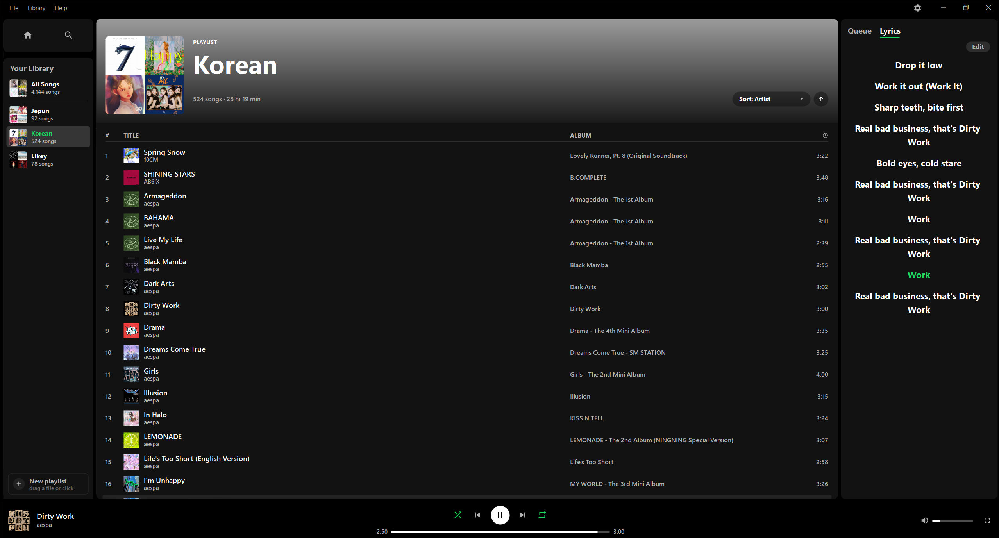
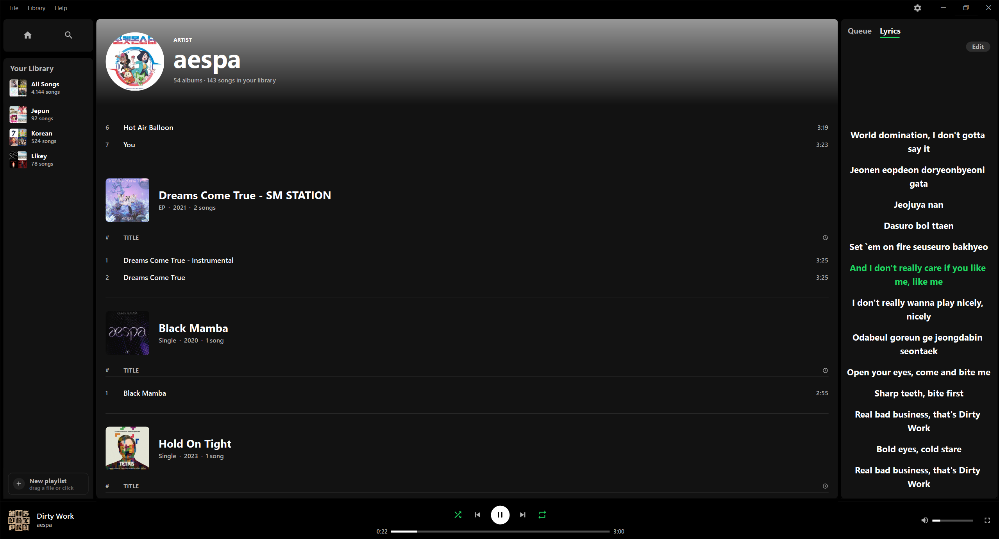
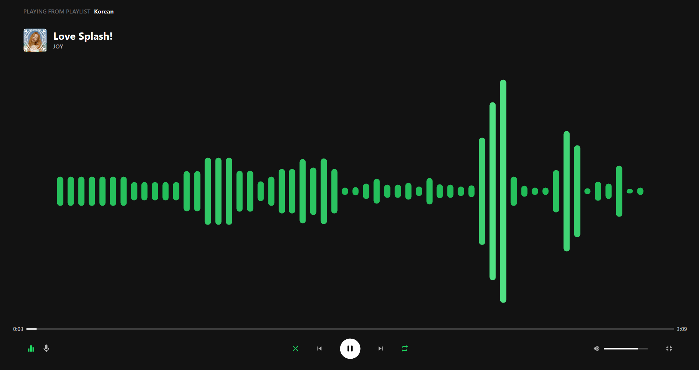
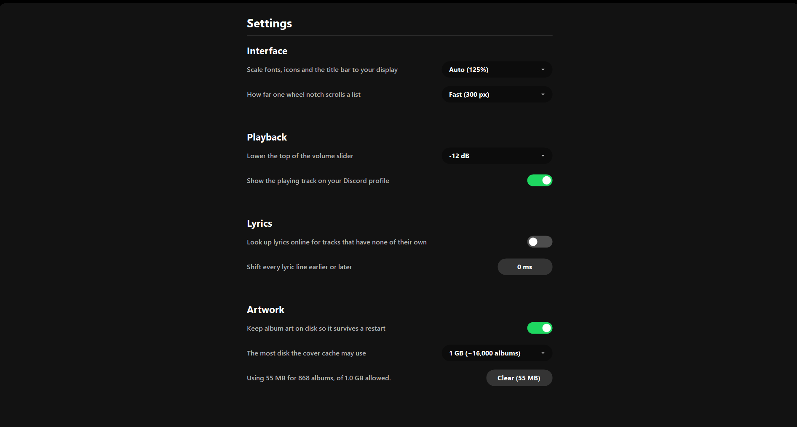
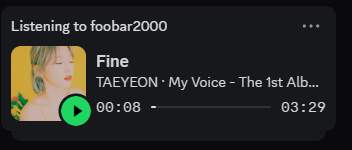

# Verdant

### A modern Spotify-style theme for foobar2000

**Verdant** is a modern **foobar2000 theme**, a visual skin that restyles your local
music library and playlists into a clean, dark, Spotify-inspired interface.

---

## Screenshots

<table>
<tr>
<td colspan="2"> <b>Home</b></td>
</tr>
<tr>
<td width="50%"> <b>Playlist</b></td>
<td width="50%"> <b>All Songs</b></td>
</tr>
<tr>
<td> <b>Search</b></td>
<td> <b>Artist</b></td>
</tr>
<tr>
<td> <b>Fullscreen</b></td>
<td> <b>Lyrics</b></td>
</tr>
<tr>
<td> <b>Visualizer</b></td>
<td> <b>Settings</b></td>
</tr>
<tr>
<td colspan="2" align="center"> <b>Discord presence</b></td>
</tr>
</table>

---

## Features

- **Home** — a horizontal shelf of your playlists with 2×2 cover mosaics, above a grid of every
  artist in your library.
- **Playlist view** — gradient header tinted from the cover art, sortable by title / artist / album,
  inline rename, delete, and drag-and-drop import **with duplicate detection**.
- **All Songs** — your entire library in one virtualised list, optionally grouped by artist, album,
  or both. Handles thousands of tracks without stuttering.
- **Search** — instant, across artists and tracks, as you type.
- **Queue / Lyrics pane** — what's actually playing next (real playback queue _and_ "next from"),
  or synced `.lrc` / plain `.txt` lyrics that roll with the track.
- **Lyrics from wherever you keep them** — a `.lrc` or `.txt` beside the track, or the track's own
  tags, or fetched from LRCLIB for the ones that have neither.
- **Fullscreen mode** — big now-playing art, rolling lyrics, or an FFT audio visualizer fed from
  real PCM. Two visualizer styles.
- **Normalize volume** — one button that levels your whole library so you stop reaching for the
  volume knob between albums.
  the "next up" list is the _actual_ upcoming order, not a guess.
- **Discord presence** — the playing track on your Discord profile, with album art and a live
  progress bar, the way Spotify does it. On by default.
- **Album art cached on disk** — covers are read from your library once, downscaled, and kept in the
  profile folder, so they survive a restart instead of being re-read every launch.
- **Space plays and pauses** — anywhere except where you're typing.

---

## Install

1. Install foobar2000 as **portable** from the [official website](https://www.foobar2000.org/download)
2. Download **`Verdant-vX.Y.Z.zip`** from the
   **[latest release](https://github.com/superziper/verdant-foobar2000-theme/releases/latest)**
3. Extract the **`profile`** folder from the zip into foobar2000's **root folder** (the one containing
   `foobar2000.exe`)
4. Start foobar2000 and enjoy

For a **standard (non-portable)** install, extract the _contents_ of `profile` into
`%APPDATA%\foobar2000-v2` instead, then start foobar2000.

### Uninstall

Run `uninstall.ps1` from `<profile>\verdant-backup\<date>\`, then delete `<profile>\verdant\` and
`<profile>\verdant-cache\`

---

## Settings

The **gear** at the top right

| Setting                   | Default         | What it does                                                                                                                                                                            |
| ------------------------- | --------------- | --------------------------------------------------------------------------------------------------------------------------------------------------------------------------------------- |
| **UI scale**              | Auto            | Scales every font, icon and the title bar. Auto follows your display's scaling                                                                                                          |
| **Output ceiling**        | Full range      | Lowers the top of the volume slider, in dB below foobar's own maximum                                                                                                                   |
| **Wheel step**            | Normal (180 px) | How far one wheel notch scrolls a list                                                                                                                                                  |
| **Discord presence**      | On              | Shows the playing track on your Discord profile. Off turns it off completely                                                                                                            |
| **Cache artwork on disk** | On              | Keeps covers between restarts instead of re-reading them from your library every launch                                                                                                 |
| **Cache size limit**      | 1 GB            | The most disk the cover cache may use                                                                                                                                                   |
| **Find lyrics online**    | On              | Looks a track up on [LRCLIB](https://lrclib.net) when it has no `.lrc` beside it _and_ no lyrics in its tags. What it finds is shown, not written — saving is yours to do from **Edit** |
| **Lyrics timing**         | 0 ms            | Shifts every lyric line. Positive shows them **earlier**, negative later                                                                                                                |

---

## Requirements

- **foobar2000 v2, 64-bit** (developed and tested on 2.25)
- **Windows 10 or 11**

---

## FAQ

**Home and All Songs look empty?** Verdant reads foobar's **Media Library**, not your playlists. A
fresh foobar has an empty library, so add a music folder under Preferences → **Media Library**.

**Is this a theme or a skin?** Both words get used for the same thing in the foobar2000 world.
Verdant is a full visual replacement.

**Will it change how my music sounds?** No. Verdant is purely visual. The one exception is
_Normalize volume_, which you have to switch on yourself and which uses foobar2000's own ReplayGain.

**Does it work with foobar2000 v1.x?** No, v2 64-bit only.

**Can I still use the Default UI / my old Columns UI layout?** Yes. Columns UI keeps layout presets,
so you can switch back at Preferences → Display → Columns UI → Layout.

**Is my music library safe?** Verdant never touches your audio files. The one feature that writes
anything is _Normalize volume_, which asks first and writes only ReplayGain tags.

**Does Verdant send anything anywhere?** One thing, and only while Discord presence is on: the
playing track's title, artist and album, to the Discord app on your own machine. Album covers are
looked up by artist and album name against public catalogues so that nothing of yours is uploaded.

---

## Credits

Built by **[superziper](https://github.com/superziper)**.

Standing on: [Columns UI](https://github.com/reupen/columns_ui) by Reupen Shah, **JSplitter** by LUR,
and [UI Wizard](https://github.com/The-Wizardium/UI-Wizard) by The Wizardium.

---

## Support

&nbsp;

## Licence

Verdant is [MIT licensed](LICENSE).

Not affiliated with or endorsed by Spotify. "Spotify" is a trademark of Spotify AB; this is a
fan-made visual theme for a local music player.
